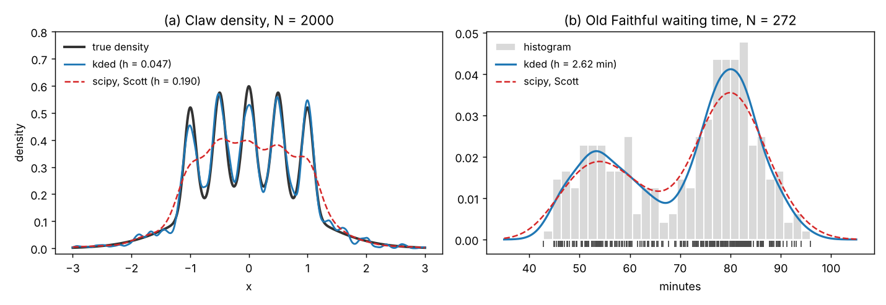
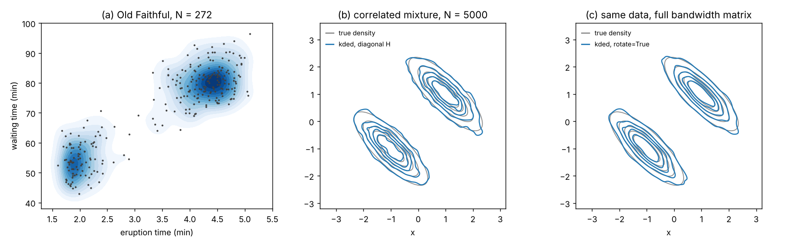
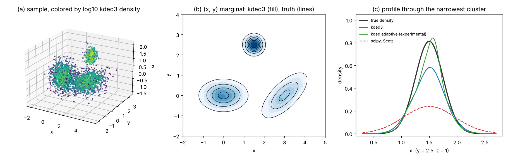
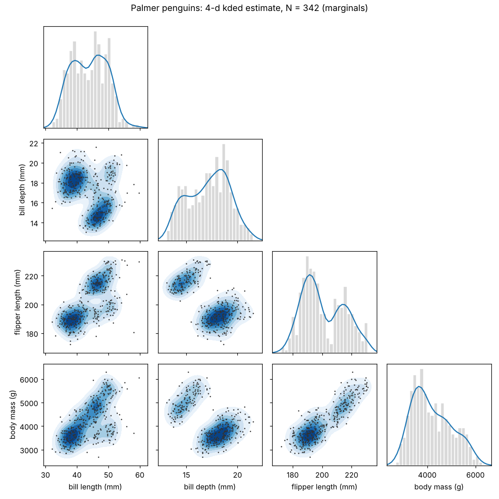
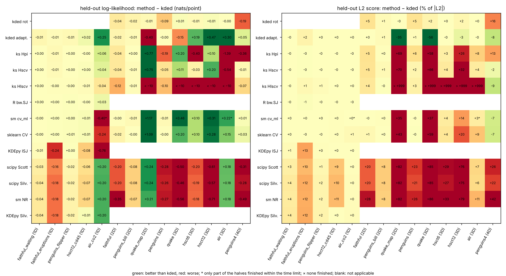
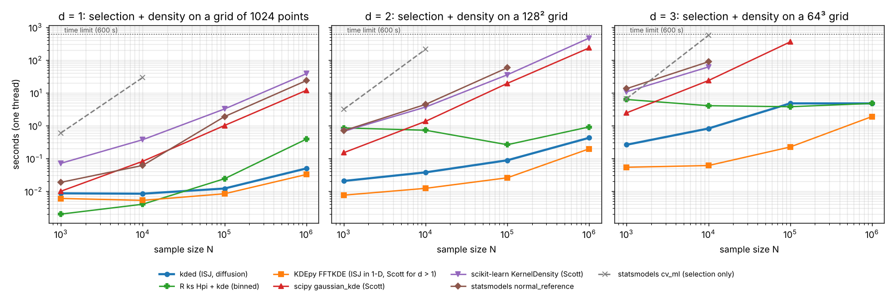

# kded: kernel density estimation via diffusion, in any dimension

[](https://pypi.org/project/kded/)
[](https://pypi.org/project/kded/)
[](https://github.com/trungnth/kded/actions/workflows/tests.yml)
[](https://github.com/trungnth/kded/blob/main/LICENSE)

`kded` estimates a probability density from a sample of points in one, two,
three or more dimensions, and chooses the amount of smoothing (the bandwidth)
automatically. It extends the diffusion estimator of Botev, Grotowski and
Kroese (2010), whose MATLAB (`kde.m`, `kde2d.m`) and Python
(`KDE-diffusion`) implementations cover only one and two dimensions, to data
of any dimension, with a focus on three-dimensional point clouds.

```python
import numpy as np
from kded import kdedn

X = np.random.default_rng(0).normal(size=(10_000, 3))   # N points in 3-D
res = kdedn(X)            # bandwidth selection + density on a 128^3 grid
res.density               # (128, 128, 128) array of density values
res.grid                  # cell centres along each axis
res.H                     # selected bandwidth matrix (kernel covariance)
res.evaluate([[0, 0, 0]]) # density at arbitrary points
```

- **No tuning, no normal reference.** The bandwidth is chosen by the
  improved Sheather–Jones (ISJ) plug-in rule, which estimates the roughness
  of the density from the data instead of assuming that the data are
  roughly Gaussian. It adapts to multimodal and clustered data, where
  rules of thumb (Scott, Silverman) oversmooth by a large factor.
- **Fast on large samples.** The points are binned on a grid and the
  estimate is computed with the discrete cosine transform, so the cost
  hardly depends on the number of points: for 10³ to 10⁶ points, selection
  and density on the default grid take under 0.1 s in 1-D, under a second
  in 2-D and 0.5 to 7 s in 3-D, on one CPU thread.
- **Any dimension.** One function, `kdedn`, for an `N × d` array; `kded1`,
  `kded2` and `kded3` are conveniences for one, two and three dimensions.
  On a grid the method is practical up to d = 4 (d = 5 with a coarse grid).
- **Validated.** In one dimension, with the histogram binning of `kde.m`
  (`binning='simple'`), the selected bandwidth agrees with Botev's `kde.m`
  to better than 10⁻¹⁰. In one to four dimensions the method was compared with the
  selectors of R `ks`, scipy, scikit-learn, statsmodels, KDEpy and MATLAB on
  simulated and open data (see [Validation](#validation)).

Contents: [Introduction](#introduction) ·
[Installation](#installation) · [Usage](#usage) ·
[Validation](#validation) · [Limitations](#limitations-and-practical-advice) ·
[Reference](#api-reference) · [Citation](#citation)

---

## Introduction

### Kernel density estimation

A kernel density estimate places a small Gaussian "bump" on each data point
and adds them up:

$$\hat f(x) = \frac{1}{N}\sum_{j=1}^{N} \phi_H(x - X_j),$$

where $\phi_H$ is the Gaussian density with covariance matrix $H$, the
*bandwidth matrix*. The estimate is only as good as $H$: too small and the
estimate is a spiky mess, too large and real structure (separate clusters,
narrow peaks, shoulders) is washed out. Choosing $H$ from the data is the
central problem, and it is harder in several dimensions, where $H$ has one
scale per axis (or a full matrix) and where different parts of the data can
live on very different scales.

### The diffusion estimator

Botev, Grotowski and Kroese (2010) observed that the Gaussian kernel
estimate is the solution of the heat (diffusion) equation started from the
data: put a unit of "heat" on every data point and let it diffuse for a time
$t$; the temperature profile at time $t$ is the kernel estimate with
bandwidth $\sqrt t$. On a box with insulating (reflecting) walls, the heat
equation is solved exactly by a cosine series, so the whole estimate can be
computed in four steps:

1. **Bin** the data on a regular grid in a box that contains them (by
   default the data range plus a quarter of the range on each side).
2. Take the **discrete cosine transform** (DCT) of the binned counts.
3. **Damp** each cosine mode by $\exp(-\tfrac{\pi^2}{2}\sum_i k_i^2 t_i)$:
   this is the diffusion for time $t_i$ along axis $i$.
4. **Inverse DCT** gives the density on the grid.

The cost is that of a few FFTs on the grid, independent of the number of
data points once they are binned. The reflecting walls also give a natural
treatment of boundaries: if the box is set to a known support (for example
`limits=[(0, None)]` for a positive variable), the estimate does not leak
mass outside it.

### Bandwidth selection: the improved Sheather–Jones rule

The bandwidth that minimizes the mean integrated squared error depends on
the unknown curvature of the density (integrals of products of its second
derivatives). Classical *plug-in* selectors estimate the curvature with a
pilot bandwidth that comes from a normal reference, i.e. from the
assumption that the density is roughly Gaussian; the assumption is poor for
clustered data and the pilot error propagates to the final bandwidth.

The ISJ rule removes the normal reference. Each functional of order $s$ is
estimated with the diffusion estimator at a pilot time that is computed from
the estimate of the functional of the next order, starting from a high order
$\ell$ (5 by default for d ≥ 2, 7 for d = 1). The whole cascade is a
function of a single time $t$, and the selected time is the **fixed point**
$t^\* = \gamma(t^\*)$ of this map. All the functionals are cheap to evaluate
in the cosine domain, so the fixed point is found in a fraction of a second.

`kded` generalizes this rule to $d$ dimensions:

- **Pilot times** for all mixed partial-derivative functionals follow from
  the same balance between bias and variance that defines the original
  one- and two-dimensional rules (for d = 1 it is the rule of `kde.m`).
- **Diagonal bandwidth matrix.** With the estimated curvature matrix, the
  per-axis bandwidths $h_1, \dots, h_d$ minimize the asymptotic mean
  integrated squared error (a small smooth convex problem, solved
  numerically in milliseconds).
- **Full bandwidth matrix.** With `rotate=True` the data are first rotated
  to their principal axes, the diagonal rule is applied there, and the
  result is rotated back, which gives a full matrix $H$ in the original
  coordinates. This helps when the clusters are strongly correlated or
  elongated along oblique directions.
- **The smallest root.** The fixed-point equation can have several roots.
  `kded` scans upwards from small times and returns the smallest root (the
  limit of Botev's own fixed-point iteration). The bracketing solvers in
  `kde.m` (2010) and `KDE-diffusion` 1.0.5 can instead fail or jump to a
  spurious, much larger root, which oversmooths everything; for the
  five-mode density (case 14) of the 1-D benchmark of Botev et al. (2010)
  with N = 1000 this happens in 9 of 10 samples.
- **Resolution check.** The selector itself is computed on the grid, so the
  grid must resolve the kernel. After a selection `kded` checks that the
  smallest kernel standard deviation spans at least two grid cells; if not,
  it refines the grid on the deficient axes (up to 2²⁴ cells and three
  refinements) and selects again, and it warns if the target cannot be
  reached. The achieved resolution is returned as `res.cells`.

**What to expect.** The ISJ rule does not assume a parametric shape, so it
does well on multimodal and clustered densities where normal-reference
rules oversmooth badly. It is not strictly consistent (asymptotically it
targets a bandwidth matrix that is somewhat too small: the loss of
efficiency is below 0.3 % for spherically symmetric densities, but 12–23 % in
two and three dimensions for a mixture of clusters with very different axis
scales). Exact least squares
cross-validation can therefore be somewhat more accurate on moderate
samples, at a cost of $O(N^2)$ per evaluation; `kded` is the fast choice for
large samples and for estimates wanted on a grid. The theory, the proofs
and all experiments are in the accompanying paper (see [Citation](#citation)).

### Adaptive estimator (experimental)

`kdedn_adaptive` builds a sample-point adaptive estimator on top of `kdedn`:
points in dense regions get narrower kernels and points in the tails wider
ones (Abramson's square-root law), with the two parameters chosen by least
squares cross-validation. In the validation below it improved the held-out
log-likelihood of flow cytometry and air quality data by 0.2 to 0.5 nats per
point, but lowered it on earthquake data. It is slower (seconds to a
minute) and not covered by the theory of the paper.

---

## Installation

`kded` needs Python ≥ 3.9 with NumPy and SciPy.

From PyPI:

```bash
pip install kded
pip install "kded[plot]"      # with matplotlib, for the examples
```

From source (latest development version):

```bash
git clone https://github.com/trungnth/kded.git
cd kded
pip install .                 # or: pip install -e ".[test]" for development
pytest                        # 19 tests, about half a minute
```

There are no compiled extensions; the package runs wherever NumPy and SciPy
run (Linux, macOS, Windows, HPC clusters). On a cluster without internet
access, copy the source distribution (`kded-0.3.0.tar.gz`) and run
`pip install kded-0.3.0.tar.gz` inside your virtual environment.

---

## Usage

All functions take the data as an `N × d` NumPy array (one row per point).
`kdedn` returns a `KDEResult`:

| Attribute / method | Meaning |
|---|---|
| `res.density` | density values on the grid, shape `(n1, ..., nd)`, indexed like the columns of `X` |
| `res.grid` | tuple of 1-D arrays: cell centres along each axis |
| `res.bandwidth` | kernel standard deviation along each axis (principal axes if `rotate=True`) |
| `res.H` | bandwidth matrix (kernel covariance) in the data coordinates |
| `res.cells` | resolution diagnostic: grid cells per smallest kernel standard deviation |
| `res.evaluate(P)` | density at points `P` (`M × d`), interpolated from the grid |
| `res.evaluate_exact(P, X)` | exact Gaussian KDE with `H` at `P` (cost `O(M N)`) |
| `density, grid, bandwidth = res` | unpacks like `KDE-diffusion` |

The scripts below are in [`examples/`](https://github.com/trungnth/kded/tree/main/examples); run them from the
repository root to regenerate the figures.

### One-dimensional data

```python
from kded import kded1, kdedn

density, grid, h = kded1(x)        # interface of Botev's kde.m: 2^14 grid points
res = kdedn(x)                     # general interface; x may be 1-D or N x 1
```

`kded1` follows the calling convention of `kde.m` and `KDE-diffusion`
(fixed grid of 2¹⁴ points, box = data range ± 10 %). The figure compares
`kded` with scipy's default (Scott's rule) on the Marron–Wand *claw*
density and on the waiting times between eruptions of the Old Faithful
geyser ([`examples/example_1d.py`](https://github.com/trungnth/kded/blob/main/examples/example_1d.py)):



Scott's rule assumes a normal shape and smooths the five narrow peaks of the
claw away; ISJ resolves them.

> **Rounded data.** The Old Faithful waiting times are whole minutes (51
> distinct values among 272 points). Any plug-in selector treats tied
> values as point masses, and the ISJ bandwidth then collapses to the
> rounding scale. Spread rounded values uniformly over their rounding
> interval before the estimate, e.g.
> `x = x + rng.uniform(-0.5, 0.5, x.shape) * resolution`.

### Two-dimensional data

```python
from kded import kded2, kdedn

density, (gx, gy), h = kded2(x, y)     # interface of Botev's kde2d.m: 256 x 256 grid
res = kdedn(np.c_[x, y])               # diagonal bandwidth matrix
res = kdedn(np.c_[x, y], rotate=True)  # full bandwidth matrix (principal axes)
```

`density[i, j]` is the estimate at `(gx[i], gy[j])`; plot it with
`plt.contourf(gx, gy, density.T)`. Panel (a): Old Faithful eruption time
against waiting time. Panels (b, c): a mixture of two strongly
anti-correlated components, with a diagonal bandwidth matrix and with
`rotate=True` ([`examples/example_2d.py`](https://github.com/trungnth/kded/blob/main/examples/example_2d.py)):



### Three-dimensional data

```python
from kded import kded3

res = kded3(X)                      # X is N x 3; same as kdedn(X)
f_grid = res.density                # 128^3 grid by default (refined if needed)
f_pts = res.evaluate(points)        # interpolated values at M x 3 points
xy = res.density.sum(axis=2) * (res.grid[2][1] - res.grid[2][0])   # (x, y) marginal
```

Three normal clusters of different sizes, one of them tilted, N = 10 000
([`examples/example_3d.py`](https://github.com/trungnth/kded/blob/main/examples/example_3d.py); `kded3` takes 1.4 s
here, on a grid refined to 189 × 147 × 147). (a) The sample colored by the
estimated density, (b) the (x, y) marginal of the 3-D estimate against the
truth, (c) a profile through the narrowest cluster, compared with scipy's
Scott rule and with the experimental adaptive estimator:



To export the gridded 3-D density to visualization software (ParaView,
OVITO, VisIt), save `res.density` together with `res.grid`, e.g. with
`np.savez("density.npz", density=res.density, x=res.grid[0], y=res.grid[1], z=res.grid[2])`
or as a VTK image with `pyevtk`/`meshio`.

### Four and more dimensions

`kdedn` accepts any `d`. The default grid is 48⁴ for d = 4 and, for d ≥ 5,
the largest grid within the budget of 2²⁴ cells (for example 27 points per
axis for d = 5). The example estimates the joint density of the four body
measurements of the Palmer penguins and shows its one- and two-dimensional
marginals ([`examples/example_nd.py`](https://github.com/trungnth/kded/blob/main/examples/example_nd.py), 4 s):



### Options of `kdedn`

| Parameter | Default | Meaning |
|---|---|---|
| `n` | 2¹⁴, 256, 128, 48 for d = 1, 2, 3, 4 | grid points per axis (an integer or one per axis); powers of two are fastest |
| `limits` | data range ± 25 % | box per axis: `(min, max)`, a number `a` for `(-a, a)`, or `None`; one end may be `None` |
| `rotate` | `False` | select in the principal axes: full bandwidth matrix |
| `refine` | `True` | resolution check (refine the grid until the kernel spans `min_cells` cells) |
| `min_cells`, `max_cells`, `max_refine` | 2, 2²⁴, 3 | target, cell budget and number of refinements of the check |
| `binning` | `'linear'` | `'simple'` gives the histogram binning of `kde.m` / `kde2d.m` |
| `max_order` | 7 (d = 1), 5 (d ≥ 2) | order at which the ISJ pilot cascade starts |

`kdedn_adaptive(X, n=None, limits=None, rotate=False, pilot=None, ...)`
returns the same result object with the extra attributes `lambdas`
(per-point kernel scale factors), `alpha` and `scale`; evaluate it at
points with `adaptive_kde_eval(X, res.H, res.lambdas, points)`.

---

## Validation

Three kinds of checks: agreement with Botev's reference implementation,
accuracy on densities with a known shape, and goodness of fit and computing
time on open data, against other KDE implementations.

### 1. Agreement with the reference implementation (d = 1, 2)

- With the histogram binning of the reference code (`binning='simple'`),
  `kded1` reproduces the bandwidth of `kde.m` / `KDE-diffusion` to a
  relative error below 10⁻¹⁰. `kded2` agrees with `kde2d.m` to about
  0.1 %, because it solves the fixed-point equation of the paper rather than
  the slightly different one of `kde2d.m`; with the latter it agrees to
  10⁻⁸. The test suite checks both.
- The 1-D benchmark of Botev et al. (2010, Table 1): 16 test densities
  (mostly the Marron–Wand suite), two sample sizes each, ten samples, ratio
  of the integrated squared errors of ISJ and of the classical
  Sheather–Jones rule (R `bw.SJ`). `kded1` gives ratios within 0.10 of the
  published ones in 27 of the 32 rows (rank correlation 0.98); ISJ is better
  than Sheather–Jones in 275 of the 320 samples, and the geometric mean ratio
  is 0.47 (published: 0.43).

### 2. Accuracy on densities with a known shape (d = 2, 3, 4)

Normal mixtures with known density: a standard normal, a correlated
normal, two- and three-cluster mixtures (with different axis scales), a
skewed and a kurtotic mixture, elongated clusters with different
correlations, and a model of atom positions in a crystal (a narrow peak,
14 small satellite peaks and a diffuse background); 7 densities for d = 2,
8 for d = 3 and 6 for d = 4, with 4 to 20 samples of each size per density
and every selector run on the same samples. The table
gives the *relative MISE*: the mean integrated squared error of the
estimate with the selected bandwidth, divided by that of the best possible
bandwidth matrix (1 = perfect selection), as a geometric mean over the test
densities. R `ks` was run with its default settings (binned for large N).

| Selector | d=2, N=10³ | d=2, 10⁴ | d=3, 10³ | d=3, 10⁴ | d=3, 10⁵ | d=4, 10³ | d=4, 10⁴ |
|---|---:|---:|---:|---:|---:|---:|---:|
| **kded** | 1.20 | 1.19 | 1.19 | 1.16 | 1.14 | 1.35 | 1.32 |
| **kded**, `rotate=True` | **1.10** | **1.08** | **1.11** | **1.09** | **1.08** | 1.27 | **1.26** |
| R `ks` `Hpi` (plug-in) | 1.77 | 1.60 | 1.76 | 1.95 | 4.96 | 2.29 | 8.38 |
| R `ks` `Hscv` (smoothed CV) | 1.79 | 1.54 | 1.54 | 1.97 | – | 1.53 | 5.39 |
| least squares CV, diagonal, unbinned | 1.24 | 1.20 | 1.17 | 1.13 | – | **1.20** | – |
| likelihood CV, diagonal (= statsmodels `cv_ml`) | 1.73 | – | 2.29 | – | – | 1.72 | – |
| scipy `gaussian_kde` (Scott) | 3.96 | 6.55 | 3.58 | 5.86 | 8.94 | 2.21 | 3.28 |
| MATLAB `mvksdensity` rule (Silverman) | 4.92 | 8.39 | 4.13 | 6.88 | 10.6 | 2.63 | 4.06 |
| *best diagonal matrix (oracle)* | *1.17* | *1.17* | *1.11* | *1.12* | *1.12* | *1.09* | *1.09* |

(– : not run, too slow.) On its worst test density the relative MISE of
`kded` is at most 1.94 in every column, whereas the worst case of the
normal-reference rules of scipy and MATLAB is 6 to 95, and that of `ks`
`Hpi` and `Hscv` 3 to 31. Exact least
squares cross-validation is a strong competitor for moderate N (and better
than `kded` for d = 4), but each evaluation of its criterion costs O(N²).
Full tables, standard errors and the test densities are in the paper.

### 3. Goodness of fit on open data (d = 1 to 4)

Fourteen data sets, from the Old Faithful geyser, the Palmer penguins and
the data sets distributed with the R package `ks`:

| Data set | d | N | Variables |
|---|---:|---:|---|
| `faithful_waiting`, `faithful_eruptions`, `faithful` | 1, 1, 2 | 272 | Old Faithful geyser: waiting time, eruption time, both |
| `penguins_flipper`, `penguins_bill`, `penguins`, `penguins4` | 1, 2, 3, 4 | 342 | Palmer penguins: flipper length; bill length and depth; both bill measures and flipper; all four with body mass |
| `hsct12_cd45`, `hsct6`, `hsct12` | 1, 3, 3 | 9 831; 6 990; 6 236 | flow cytometry of stem cell transplants (`ks::hsct`): one marker, or three markers of one mouse |
| `quake_map`, `quake` | 2, 3 | 2 978; 2 180 | severe earthquakes (`ks::quake`): longitude, latitude (and depth) |
| `air_co2`, `air` | 1, 3 | 27 721 | hourly air quality in a Paris metro station (`ks::air`): CO₂; NO₂, PM10 and CO₂ |

Each data set is split at random into two halves, five times; every
selector is run on one half and scored on the other, in both directions,
which gives ten scores per selector and data set. Two scores are used:
the **held-out log-likelihood** (mean log-density at the test points; higher
is better), and the **held-out L2 score**, ∫f̂² − 2·mean f̂(test points),
which estimates the integrated squared error up to a constant (lower is
better). Every selector is scored as the exact Gaussian KDE with the
bandwidth matrix it selected, so only bandwidth selection is compared.
Rounded values are spread over their rounding interval, events censored
at zero (flow cytometry) and catalogue default depths (earthquakes) are
removed. The selectors are used through each library's public API with
default settings; scikit-learn uses the usual recipe of standardized data,
one bandwidth and `GridSearchCV` (5-fold, 40 bandwidths). Each fit runs on
one thread.

The scores come from a run on the JINR HybriLIT cluster, with a time limit
of 12 hours per selection. The selection times come from a second run of
the same benchmark on one 4-core machine (Intel Xeon, 2.1 GHz) with a limit
of 10 minutes, because on the cluster's Xeon Phi nodes the selections were
8 to 60 times slower, by a factor that depends on the library. Both runs
selected the same bandwidth matrices (to within 2·10⁻⁴, relative), so they
gave the same scores. Software: `kded` 0.3.0, Python 3.13, numpy 2.5,
scipy 1.18, scikit-learn 1.9, statsmodels 0.15, KDEpy 1.1.12, R 4.3.3 with
`ks` 1.14.2.

The figure shows each selector against `kded` on every data set (green:
better than `kded`, red: worse):



Summary over the data sets. On each data set the selectors run on it are
ranked by their mean score, from 0 (best) to 1 (worst), and the table gives
the average rank over the data sets. Times are per selection on one thread
of the 4-core machine: the median over the data sets and the largest single
fit (> 600: stopped at the 10-minute limit). \*: statsmodels `cv_ml`
finished only 5 of the 10 halves of `air_co2` and 4 of `air` within 12
hours; there it is ranked by its difference to `kded` on those halves.

| Selector | data sets | log-likelihood: mean rank | L2 score: mean rank | median time (s) | largest time (s) |
|---|---:|---:|---:|---:|---:|
| **kded** | 14 | 0.38 | 0.22 | 0.16 | 19 |
| **kded, rotate=True** | 9 | 0.56 | 0.37 | 4.15 | 21 |
| **kded adaptive (experimental)** | 14 | 0.29 | 0.23 | 7.26 | 51 |
| R ks Hpi (plug-in) | 14 | 0.48 | 0.38 | 0.07 | 9.85 |
| R ks Hscv (smoothed CV) | 14 | 0.40 | 0.38 | 0.81 | 210 |
| R ks Hlscv (least squares CV) | 14 | 0.70 | 0.58 | 0.76 | 191 |
| R bw.SJ (Sheather-Jones) | 5 | 0.32 | 0.05 | <0.01 | <0.01 |
| statsmodels cv_ml | 14* | 0.24 | 0.35 | 8.64 | > 600 |
| scikit-learn GridSearchCV | 14 | 0.24 | 0.45 | 1.15 | 244 |
| KDEpy ISJ | 5 | 0.75 | 0.68 | <0.01 | 0.02 |
| scipy gaussian_kde (Scott) | 14 | 0.71 | 0.79 | <0.01 | 0.01 |
| scipy gaussian_kde (Silverman) | 14 | 0.72 | 0.80 | <0.01 | 0.02 |
| statsmodels normal_reference | 14 | 0.75 | 0.90 | <0.01 | 0.02 |
| KDEpy Silverman | 5 | 0.60 | 0.82 | <0.01 | <0.01 |

What the comparison shows:

- **Normal-reference rules** (scipy `gaussian_kde` with Scott's or
  Silverman's rule, statsmodels `normal_reference`, KDEpy Silverman) are the
  defaults of most Python libraries. The L2 score of scipy and statsmodels
  was worse than that of `kded` on all fourteen data sets (by 0.4 % to 86 %),
  and their log-likelihood on eleven of fourteen.
- **KDEpy's ISJ** (1-D only) implements the same rule as `kded` on a
  coarser grid (2¹⁰ points over at least twice the data range). Its L2
  score was worse than that of `kded` on all five 1-D data sets (by 0.1 %
  to 13 %), and its log-likelihood on four of five (by up to 0.76 nats per
  point).
- **R `ks`**: in one dimension the plug-in (`hpi`) and smoothed
  cross-validation (`hscv`) selectors and the classical Sheather–Jones rule
  (`bw.SJ`) did as well as `kded` or marginally better: their L2 score was
  lower on all five 1-D data sets, but by at most 0.6 %, and their
  log-likelihood differed by at most 0.07 nats per point. In two to four
  dimensions the L2 score of `Hpi` was worse than that of `kded` on all nine
  data sets and that of `Hscv` on eight of nine (by up to 70 %); their
  log-likelihood was higher on the earthquake data and on `hsct12`, and
  about equal or lower elsewhere (by up to 1.4 nats per point, on `air`).
  Least squares cross-validation (`Hlscv`, binned at these sample sizes by
  default) broke down on the five larger 2-D and 3-D data sets
  (earthquakes, flow cytometry, air quality): it returned nearly singular
  bandwidth matrices.
- **Likelihood cross-validation** (statsmodels `cv_ml`, scikit-learn
  `GridSearchCV`) maximizes the held-out likelihood by construction. On the
  earthquake data and the 3-D flow cytometry data, which have isolated
  points and heavy tails, it reached a higher log-likelihood than `kded` (by
  0.1 to 1.2 nats per point), at the price of a worse L2 score on the same
  data (by 4 % to 59 %); the same held on the 3-D air quality data.
  Elsewhere the two agree within 0.03 nats per point, except on `air_co2`,
  where likelihood cross-validation was 0.24 (scikit-learn) and 0.40
  (statsmodels, five halves) nats per point lower, mostly because of one
  half on which it chose less than half the bandwidth of `kded`. On the 4-D
  penguin data both had a lower L2 score than `kded` (by 7 %).
- **Computing time.** On the small data sets (272 and 342 points) every
  fixed-bandwidth selector took less than 5 s (the adaptive estimator up to
  10 s in 4-D). Likelihood cross-validation costs O(N²) per evaluation of
  its criterion: on the 14 000-point halves of the air quality data
  scikit-learn took about 3 minutes per selection, and statsmodels finished
  two of the ten halves of `air_co2` within 10 minutes and none of `air`,
  against 0.04 s (1-D) and 9 s (3-D) for `kded`. On the 3-D data sets with
  1 000 to 14 000 points per half, `ks` `Hscv` and `Hlscv` took up to 3.5
  minutes per selection and `kded` at most 19 s (on the earthquake data,
  where the resolution check refined the grid).
- **`rotate=True`** did not help on these data (L2 score worse on eight of
  nine data sets); its gain is for clusters elongated along oblique
  directions (section 2).
- **The adaptive estimator** (`kdedn_adaptive`, experimental) is close to
  `kded` in average L2 rank and to likelihood cross-validation in
  log-likelihood rank. It gained 0.2 to 0.5 nats per point on the 3-D flow
  cytometry and on the air quality data and reduced the L2 score of the
  earthquake data by 35 to 56 % (while lowering their log-likelihood), at 5
  to 45 s per fit on these data.

In short: among the selectors that work in every dimension, `kded` and its
adaptive variant have the best average rank in L2 score, the accuracy
criterion `kded` is designed for, and `kded` is far ahead of the rules of
thumb. When the held-out log-likelihood matters most, likelihood
cross-validation (for moderate N) fits better on data with isolated points
such as the earthquakes, and the adaptive estimator on the flow cytometry
and air quality data.
Tables per data set: [`benchmarks/results/summary.md`](https://github.com/trungnth/kded/blob/main/benchmarks/results/summary.md);
scripts and raw results: [`benchmarks/`](https://github.com/trungnth/kded/tree/main/benchmarks).

### 4. Computing time

Time for automatic bandwidth selection plus the density on a grid (1024
points in 1-D, 128² in 2-D, 64³ in 3-D), for 10³ to 10⁶ points drawn from a
two-component normal mixture, on one thread of the 4-core machine of
section 3 (median of three runs, one run when it took more than a minute; a
run was stopped after 10 minutes). Scripts: `benchmarks/timing.py` and
`benchmarks/timing_ks.R`.



- `kded` and R `ks` bin the points onto a grid, so their cost grows slowly
  with N. `kded` took 0.01 to 0.05 s in 1-D, 0.02 to 0.4 s in 2-D and 0.3 to
  5 s in 3-D; in 3-D the bandwidth shrinks as N grows, and the resolution
  check refined the initial 64³ grid up to the budget of 2²⁴ cells (about
  256³). `ks` (`Hpi` and `kde`, binned) took up to 0.4 s in 1-D, up to
  0.9 s in 2-D and 4 to 6 s in 3-D.
- scipy `gaussian_kde`, scikit-learn `KernelDensity` and statsmodels sum
  the kernels of all N points at every grid point, so even with a
  rule-of-thumb bandwidth (no selection) their time grows about in
  proportion to N: in 3-D they needed 2 to 13 s for 10³ points and 24 to
  88 s for 10⁴ points, and for 10⁵ points only scipy finished (6 minutes).
  Likelihood cross-validation (statsmodels `cv_ml`, selection only) grows
  faster: for 10⁴ points it took 29 s in 1-D, 3.5 minutes in 2-D and
  9.4 minutes in 3-D.
- KDEpy `FFTKDE`, also based on binning and the FFT, is the fastest in 2-D
  and 3-D, but there it selects no bandwidth: it was run with Scott's rule
  on standardized data. In 1-D, where it selects the bandwidth with ISJ, it
  took 0.005 to 0.03 s.

With its default grids (2¹⁴ points in 1-D, 256² in 2-D, 128³ in 3-D),
`kdedn` took 0.03 to 0.09 s in 1-D, 0.03 to 0.5 s in 2-D and 0.5 to 7 s in
3-D for the same sample sizes.

---

## Limitations and practical advice

- **Grid size and memory.** The estimate is stored on an `n^d` grid in
  double precision: 128³ cells take 16 MB, the default budget of 2²⁴ cells
  134 MB (plus work arrays of the same size). If the resolution check warns
  that the budget is reached, either accept the coarser result, narrow the
  box with `limits` (keep a margin of a few bandwidths around the data), or
  raise `max_cells`.
- **Dimension.** On a grid the method is practical up to d = 4; for d = 5
  the default grid has only 27 points per axis, which resolves only broad
  features. In higher dimensions a grid-free estimator (the exact Gaussian
  KDE with a cross-validated bandwidth) is usually more practical.
- **Rounded or discrete data.** Jitter tied values over their rounding
  interval (see the 1-D example). Point masses (censored values, default
  codes such as a depth of 10 km) dominate any bandwidth selector; remove or
  model them separately.
- **Bounded support.** Set `limits` to the known support on that axis; the
  reflecting faces then remove most of the boundary bias.
- **Clusters along oblique directions.** Try `rotate=True`; compare the
  held-out log-likelihood of both choices if in doubt.
- **Very different local scales** (a sharp peak on a broad background): the
  single global bandwidth matrix is a compromise (panel (c) of the 3-D
  example); try `kdedn_adaptive`.
- **Large samples.** Binning makes the cost independent of `N` once the
  points are on the grid; binning 10⁷ points in 3-D takes a few seconds.
- **Run time.** A 3-D selection on the default 128³ grid takes about half
  a second. For large samples the selected bandwidth is small, the
  resolution check refines the grid (up to the budget of 2²⁴ cells, about
  256³), and the selection takes 5 to 10 s. Narrow clusters far apart (a
  small bandwidth in a wide box) also drive the grid to the budget, and the
  selection can then take a minute or more; `refine=False` or narrower `limits` make it fast
  again, at the price of a coarser selector.

---

## API reference

| Function | Purpose |
|---|---|
| `kdedn(X, n=None, limits=None, rotate=False, ...)` | diffusion KDE with ISJ bandwidth, any dimension; returns `KDEResult` |
| `kded1(x, n=2**14, limits=None)` | 1-D, interface of `kde.m`; returns `(density, grid, h)` |
| `kded2(x, y, n=256, limits=None)` | 2-D, interface of `kde2d.m`; returns `(density, (gx, gy), h)` |
| `kded3(X, n=128, limits=None, ...)` | 3-D (checks that `X` is `N × 3`); returns `KDEResult` |
| `kdedn_adaptive(X, ...)` | sample-point adaptive estimator (experimental) |
| `gaussian_kde_eval(X, H, P)` | exact Gaussian KDE with bandwidth matrix `H` at points `P` |
| `adaptive_kde_eval(X, H, lambdas, P)` | exact adaptive KDE at points `P` |
| `amise_diagonal(psi2, N)` | AMISE-optimal diagonal bandwidths for a given curvature matrix |

Every function has a docstring (`help(kded.kdedn)`).

**Differences from Botev's implementations.** `kded1`/`kded2` return the
cell centres (not the left bin edges) as `grid`, use linear binning by
default (`binning='simple'` reproduces the histogram binning), and return
the smallest root of the fixed-point equation. `kde2d.m` solves a slightly
different equation, $t = (t-\gamma(t))/\gamma(t)$, which changes the bandwidth by
about 0.1 %.

**Names before version 0.3.0.** Up to version 0.2.2 the package was called
`kde3d` (module `kde_diffusion_nd`, functions `kde_nd`, `kde1d`, `kde2d`,
`kde3d`, `kde3d_adaptive`). Version 0.3.0 renames them to `kded`, `kdedn`,
`kded1`, `kded2`, `kded3` and `kdedn_adaptive`; results are identical bit
for bit. See [CHANGELOG.md](https://github.com/trungnth/kded/blob/main/CHANGELOG.md).

---

## Citation

If you use `kded`, please cite the paper that describes the method and the
original diffusion estimator:

```bibtex
@unpublished{kded,
  author = {Nguyen, Trung},
  title  = {kded: An extension of kernel density estimation via diffusion
            for multivariate data},
  note   = {Manuscript},
  year   = {2026}
}

@article{botev2010,
  author  = {Botev, Z. I. and Grotowski, J. F. and Kroese, D. P.},
  title   = {Kernel density estimation via diffusion},
  journal = {The Annals of Statistics},
  volume  = {38},
  number  = {5},
  pages   = {2916--2957},
  year    = {2010},
  doi     = {10.1214/10-AOS799}
}
```

A machine-readable citation is in [CITATION.cff](https://github.com/trungnth/kded/blob/main/CITATION.cff).

## Author

Trung Nguyen, Dalat Nuclear Research Institute (trungnth@gmail.com).
Questions, bug reports and suggestions are welcome as
[GitHub issues](https://github.com/trungnth/kded/issues).

## License

MIT, see [LICENSE](https://github.com/trungnth/kded/blob/main/LICENSE). The example data are the Old Faithful geyser
data of R (`datasets::faithful`) and the Palmer penguins data (CC0; Horst,
Hill and Gorman 2020).
